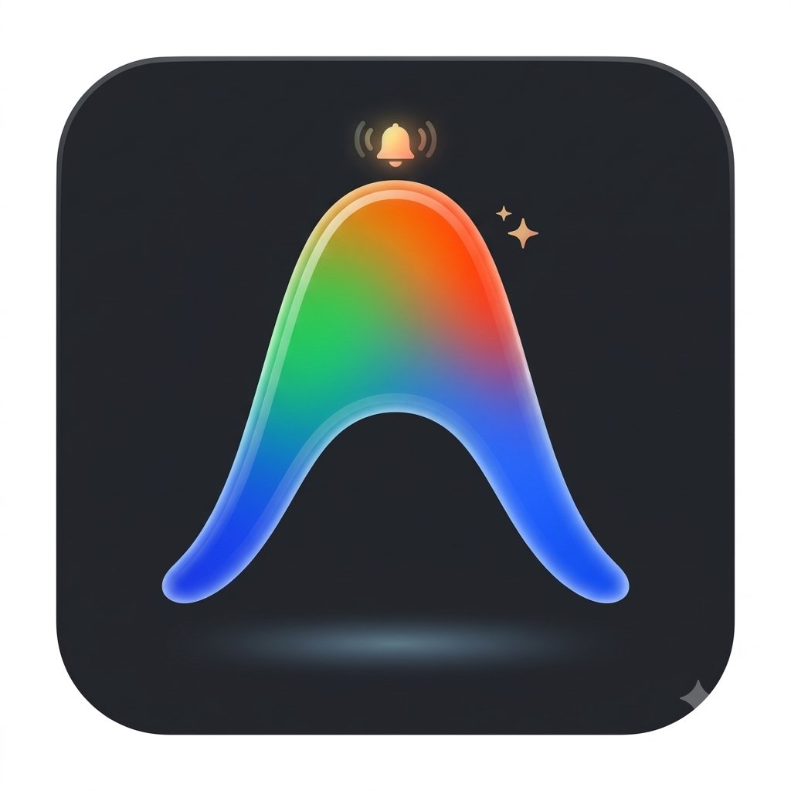
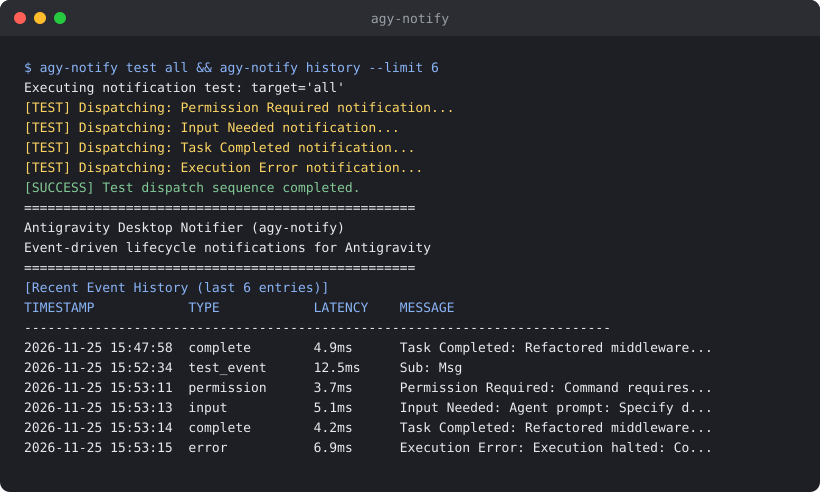

# Antigravity Desktop Notifier (`agy-notify`)

Event-driven desktop notifications with official Antigravity branding for **macOS**, **Windows**, and **Linux**.

---

## Overview

Antigravity Desktop Notifier eliminates agent idle time by dispatching native desktop banners and audible alerts whenever the agent requires approval, seeks user clarification, or completes a turn.

Unlike polling scripts that degrade system performance, `agy-notify` integrates directly into Antigravity's native lifecycle hook loop (`PreToolUse` and `Stop`).

---

## Core Capabilities

- **Official Brand Assets**: High-resolution Antigravity icons on macOS (native `.app` bundle), Windows 10/11 (Toast `appLogoOverride`), and Linux (`notify-send -i`).
- **Zero-Dependency Architecture**: Leverages built-in OS dispatchers (macOS Notification Center, Windows WinRT PowerShell, Linux freedesktop).
- **Event Lifecycle Triggers**:
  - `Permission Required`: Dispatched before elevated tools or sandbox elevation steps execute.
  - `Input Needed`: Dispatched when `ask_question` pauses execution for user input.
  - `Task Completed`: Dispatched on `NO_TOOL_CALL` termination when the turn finishes.
  - `Execution Error`: Dispatched on runtime exceptions or token budget limits.
- **Enterprise Features**:
  - **Diagnostic Engine (`doctor`)**: Automated environment, backend, and configuration verification.
  - **Metrics & Audit Ledger (`metrics`, `history`)**: Tracks event delivery rates and latencies in local append-only JSONL.
  - **Remote Webhooks**: Asynchronous forwarding to Slack, Discord, ntfy, or custom HTTP endpoints.
  - **Quiet Hours**: Automated audio chime suppression during configurable time windows.
  - **Structured Logging**: Rotating file logs (`notifier.log`) with configurable levels.

---

## Screenshots

### Desktop notification

<!-- Add a real capture of the banner at docs/screenshots/notification.png, then uncomment:

-->

The banner is posted by `Antigravity Notifier.app` on macOS, so it carries the Antigravity icon:

<p align="center"></p>

### CLI in action

Real output of `agy-notify test all` followed by `agy-notify history`:



---

## Download

Prebuilt binaries are attached to every [GitHub Release](../../releases):

| Platform | Asset |
| :--- | :--- |
| macOS (Apple Silicon, arm64) | `agy-notify-<version>-macos-arm64.tar.gz` |
| Windows (x86_64) | `agy-notify-<version>-windows-x86_64.zip` |
| Linux (x86_64) | `agy-notify-<version>-linux-x86_64.tar.gz` |

Each archive has a `.sha256` checksum. Extract it, then run `./agy-notify install` (`agy-notify.exe install` on Windows) to register the hook. Keep the `assets/` folder (and `bin/Antigravity Notifier.app` on macOS) next to the executable.

### Cutting a release

```bash
git tag v1.0.0
git push origin v1.0.0
```

Pushing a `v*.*.*` tag runs `.github/workflows/release.yml`, which tests, builds all three binaries with PyInstaller, smoke-tests each one, and publishes the archives to a GitHub Release. The workflow can also be run manually from the Actions tab to produce build artifacts without publishing.

---

## Installation

### macOS / Linux

Execute within the repository directory:

```bash
chmod +x install.sh && ./install.sh
```

### Windows (PowerShell)

Open an elevated PowerShell prompt in the repository directory:

```powershell
.\install.ps1
```

The installer registers the lifecycle hook in `~/.gemini/config/hooks.json` and creates a symlink in `~/.local/bin/agy-notify`.

---

## Platform Dispatch Matrix

| Platform | Notification Dispatcher | Icon Strategy | Audio Subsystem |
| :--- | :--- | :--- | :--- |
| **macOS** | Native Notification Center via `Antigravity Notifier.app` | Embedded `AppIcon.icns` bundle | `/usr/bin/afplay` (`Glass`, `Hero`, `Ping`, etc.) |
| **Windows** | WinRT XML Toast via PowerShell | `<image placement="appLogoOverride" src="icon.png"/>` | Windows System Sound Events (`ms-winsoundevent`) |
| **Linux** | Freedesktop `notify-send` | `notify-send -i assets/icon.png` | `paplay` (PulseAudio), `pw-play` (PipeWire), `aplay` |

---

## CLI Reference

### System Verification & Diagnostics

```bash
# Run system diagnostics
agy-notify doctor

# Display registration status and active configuration
agy-notify status

# View aggregate delivery statistics
agy-notify metrics

# View recent notification audit history
agy-notify history --limit 20
```

### Testing

```bash
# Test all notification events sequentially
agy-notify test all

# Test specific notification event
agy-notify test permission
agy-notify test input
agy-notify test complete
agy-notify test error
```

### Hook Management

```bash
# Register globally (applies across all workspaces)
agy-notify install

# Register workspace-locally (.agents/hooks.json)
agy-notify install --workspace

# Remove registration
agy-notify uninstall
```

### Configuration

Configuration is managed at `~/.config/antigravity-notifier/config.json`:

```bash
# Inspect current configuration
agy-notify config list

# Enable quiet hours (22:00 to 08:00)
agy-notify config set quiet_hours.enabled true
agy-notify config set quiet_hours.start 22:00
agy-notify config set quiet_hours.end 08:00

# Configure Slack/Discord webhook forwarding
agy-notify config set webhook_url "https://hooks.slack.com/services/..."

# Enable spoken audio announcements
agy-notify config set voice_enabled true

# Automatically focus Antigravity IDE on notification
agy-notify config set focus_window_on_alert true

# Adjust duplicate event suppression cooldown (seconds)
agy-notify config set cooldown_seconds 5
```

---

## Project Structure

```
.
├── assets/
│   ├── icon.png                  # Master PNG icon (Windows Toast / Linux)
│   ├── icon.icns                 # macOS native multi-resolution icon bundle
│   └── icon.ico                  # Windows native icon
├── bin/
│   ├── agy-notify                # CLI executable and lifecycle hook handler
│   ├── agy-notify.bat            # Windows cmd launcher
│   └── Antigravity Notifier.app/ # macOS background applet bundle
├── lib/
│   ├── config.py                 # Configuration persistence and schema validation
│   ├── doctor.py                 # System health and diagnostic suite
│   ├── hooks.py                  # Antigravity hook input/output contract parser
│   ├── installer.py              # hooks.json reader/writer with auto-backups
│   ├── logger.py                 # Rotating structured logger
│   ├── metrics.py                # Event history and telemetry metrics
│   ├── notifier.py               # Cross-platform dispatch engine
│   ├── watcher.py                # Fallback transcript monitor daemon
│   └── webhook.py                # Asynchronous webhook dispatcher
├── install.sh                    # Automated macOS/Linux installer
├── install.ps1                   # Automated Windows PowerShell installer
├── test_suite.py                 # Unit test suite
└── README.md                     # Technical documentation
```
